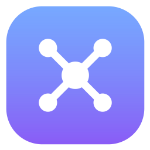
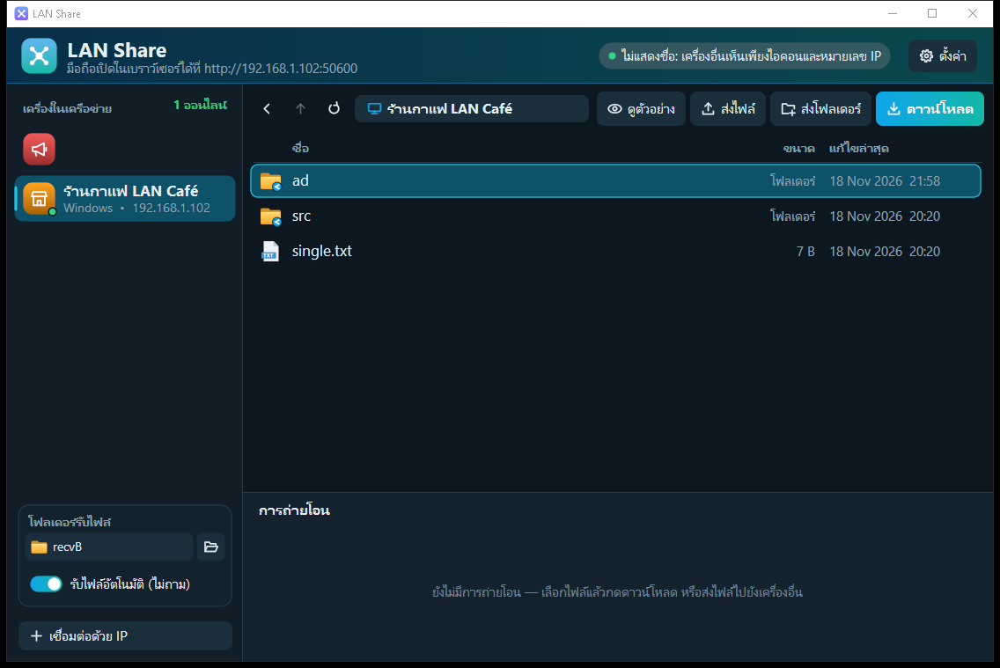
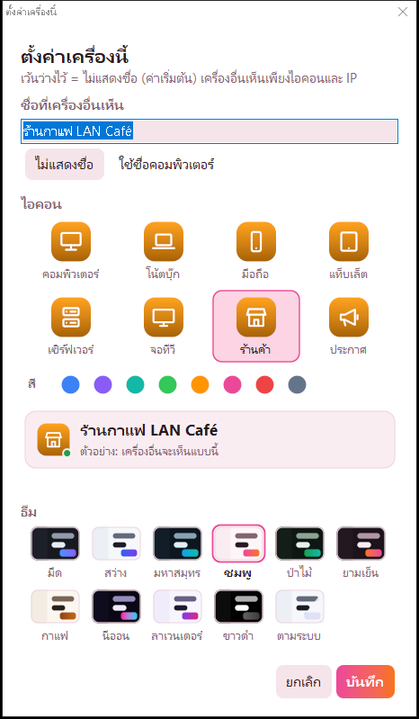
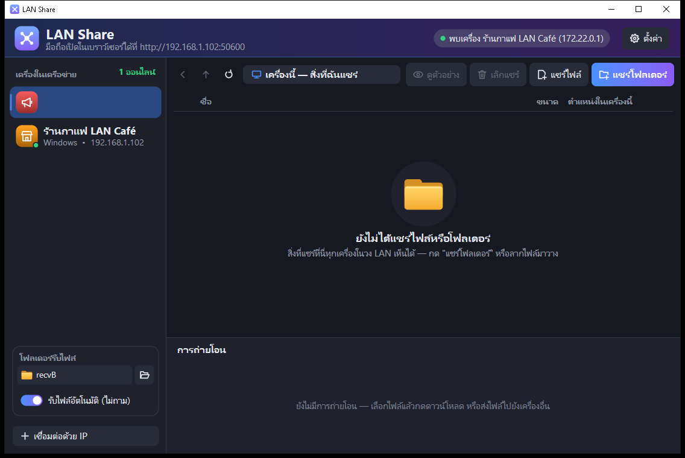
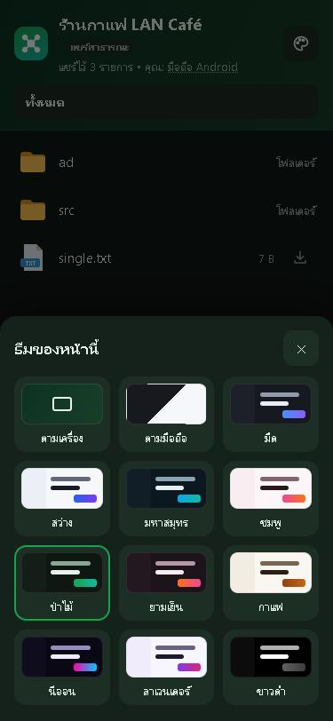

# LAN Share — แชร์ไฟล์และโฟลเดอร์ในวง LAN (Lazarus / Free Pascal + BGRABitmap)

รองรับ **Windows, Linux, macOS** — ทุกเครื่องที่เปิดโปรแกรมจะ**เชื่อมต่อเห็นกันเองอัตโนมัติ**ในวง LAN
และเปิดดูไฟล์ที่อีกเครื่องแชร์ไว้ได้แบบ Explorer — เป็นการแชร์แบบ**สาธารณะ** (ไม่มีรหัสผ่าน ทุกคนในวง LAN เห็นสิ่งที่แชร์)




## ความสามารถ
- **เชื่อมต่ออัตโนมัติ**: ประกาศตัวด้วย UDP broadcast, ตอบเครื่องใหม่ทันที, จำเครื่องที่เคยเจอ
  และลองหาในวง /24 เดียวกันทุก 60 วินาที จึงเจอกันได้แม้ router/Wi-Fi บางรุ่นบล็อก broadcast
- **ซ่อนชื่อเครื่องเป็นค่าเริ่มต้น**: ถ้าไม่ได้ตั้งชื่อ จะไม่มีข้อความใดๆ — "เครื่องนี้" ในแถบซ้ายแสดงเพียงไอคอน
  เครื่องอื่นเห็นเพียงไอคอนและหมายเลข IP และชื่อคอมพิวเตอร์จริงจะไม่ถูกส่งออกไป
- **ธีม 11 แบบ**: มืด สว่าง มหาสมุทร ชมพู ป่าไม้ ยามเย็น กาแฟ นีออน ลาเวนเดอร์ ขาวดำ และตามระบบ (ตามโหมดสว่าง-มืดของ Windows)
  เลือกในปุ่ม **ตั้งค่า** เปลี่ยนทันที — **หน้าเว็บบนมือถือเปลี่ยนตามธีมของเครื่องเองด้วย** (ภายใน 10 วินาที ไม่ต้องรีเฟรช)
  หรือกดปุ่มจานสีมุมขวาบนของหน้าเว็บ เพื่อเลือกธีมของมือถือเอง: "ตามเครื่อง" (ค่าเริ่มต้น), "ตามมือถือ" (โหมดสว่าง/มืดของโทรศัพท์)
  หรือธีมใดก็ได้ — มือถือจำไว้ และใช้กับหน้าโฆษณา/จอโฆษณาด้วย
  เพิ่มธีมใหม่ได้ด้วยการเพิ่มหนึ่งบรรทัดในตาราง `PALETTES` ของ `uitheme.pas`

    
- **ตั้งชื่อ / ไอคอนเองได้**: ปุ่ม **ตั้งค่า** มุมขวาบน — ตั้งชื่อ เลือกไอคอน 8 แบบ
  (คอมพิวเตอร์ โน้ตบุ๊ก มือถือ แท็บเล็ต เซิร์ฟเวอร์ จอทีวี ร้านค้า ประกาศ) และสี 8 สี เครื่องอื่นเห็นทันที
- **หน้าประกาศ / โฆษณาด้วย Markdown**: แชร์ไฟล์ `.md` แล้วเปิดดูเป็นหน้าเว็บสวยงาม
  แทรกรูป **PNG JPG GIF**, **PDF** และวิดีโอ **MP4** ได้ — ดูหัวข้อ "ทำหน้าโฆษณา" ด้านล่าง
- **ห้องแชร์ของแต่ละเครื่อง**: แถบซ้ายแสดง "เครื่องนี้" และทุกเครื่องในวง LAN ที่เปิด LAN Share อยู่ (พบอัตโนมัติ)
  - **เครื่องนี้**: เลือกโฟลเดอร์/ไฟล์ที่จะแชร์ (ปุ่ม แชร์โฟลเดอร์ / แชร์ไฟล์ หรือลากมาวาง) และเลิกแชร์ได้
    ดับเบิลคลิกโฟลเดอร์ที่แชร์เพื่อดูไฟล์/โฟลเดอร์ย่อยข้างใน (เห็นเหมือนที่เครื่องอื่นเห็น) และ "เปิดในเครื่อง" เพื่อเปิดใน Explorer
  - **เครื่องอื่น**: คลิกเพื่อเปิดดูสิ่งที่เขาแชร์ ดับเบิลคลิกเข้าโฟลเดอร์ ย้อนกลับ / ขึ้นระดับ / คลิกที่แถบตำแหน่ง แล้วกด **ดาวน์โหลด** (ทั้งไฟล์และทั้งโฟลเดอร์ เลือกหลายรายการได้ด้วย Ctrl/Shift)
  - ส่งไฟล์/โฟลเดอร์ **ไปยัง** เครื่องนั้นได้ด้วย (ปลายทางกดยอมรับ หรือเปิด "รับไฟล์อัตโนมัติ")
- **มือถือ / Android**:
  - เปิด `http://<IP ของเครื่อง>:50505` ในเบราว์เซอร์มือถือได้เลย (ที่อยู่แสดงบนแถบหัวของโปรแกรม) — เปิดดู ดาวน์โหลด และส่งไฟล์มาที่ PC
  - มี HTTP/JSON API สำหรับทำแอป Android ในอนาคต (list / tree / ดาวน์โหลดต่อด้วย Range / ส่งไฟล์แบบมีการยืนยัน) — สเปกอยู่ใน [PROTOCOL.md](PROTOCOL.md)
  - อุปกรณ์ที่ประกาศตัวเป็น Android/iOS จะแสดงเป็นไอคอนมือถือในแถบซ้าย
- **แผงการถ่ายโอน**: แถบความคืบหน้า ความเร็ว สถานะ และปุ่มยกเลิก ทั้งฝั่งที่ส่งและฝั่งที่รับ
- **หน้าตา**: วาดทั้งหมดด้วย BGRABitmap (ธีมมืด ไอคอนเวกเตอร์ตามชนิดไฟล์ ปุ่มไล่สี) คมชัดทุก DPI
- **ปลอดภัย**: แชร์เป็นแบบอ่านอย่างเดียว เครื่องอื่นเข้าถึงได้เฉพาะโฟลเดอร์/ไฟล์ที่แชร์ไว้เท่านั้น
  (path ที่มี `..` หรือพยายามออกนอกแชร์จะถูกปฏิเสธ) และไฟล์ที่รับเข้ามาจะถูกเขียนเฉพาะในโฟลเดอร์รับไฟล์

## ดาวน์โหลด / ติดตั้ง (รุ่น 1.0.0)
| ระบบ | ไฟล์ | วิธีใช้ |
|---|---|---|
| Windows 10/11 (64-bit) | `LanShare-1.0.0-windows-x64.zip` | แตกไฟล์แล้วเปิด `LanShare.exe` — ไม่ต้องติดตั้ง (การตั้งค่าเก็บข้างไฟล์ exe) |
| Linux (64-bit, GTK2) | `LanShare-1.0.0-linux-x64.tar.gz` | แตกไฟล์แล้วรัน `./LanShare` หรือ `./install.sh` เพื่อเพิ่มในเมนูโปรแกรม (ต้องมี `libgtk2.0-0`) |
| macOS | — | ยังไม่มีไฟล์สำเร็จรูป ต้อง build เอง (ดูหัวข้อ Build) |

ดูสิ่งที่มีในรุ่นนี้ได้ที่ [CHANGELOG.md](CHANGELOG.md)

## ภาพหน้าจอ
| | |
|---|---|
|  |  |
|  |  |

## License
LAN Share เผยแพร่ภายใต้ **MIT License** — ดู [LICENSE](LICENSE)
ใช้ แก้ไข และแจกจ่ายต่อได้ รวมถึงใช้ในเชิงพาณิชย์ โดยต้องคงข้อความลิขสิทธิ์และสัญญาอนุญาตไว้

ไลบรารีที่ฝังอยู่ในโปรแกรม (Free Pascal RTL, Lazarus LCL, BGRABitmap) ใช้ modified LGPL ซึ่งอนุญาตให้ใช้ร่วมกับโปรแกรมที่มีสัญญาอนุญาตใดก็ได้
— รายละเอียดใน [THIRD-PARTY-NOTICES.md](THIRD-PARTY-NOTICES.md)

## ไฟล์ในโปรเจกต์
| ไฟล์ | หน้าที่ |
|---|---|
| `LanShare.lpi` / `LanShare.lpr` / `LanShare.res` | โปรเจกต์ Lazarus |
| `mainform.pas` | หน้าต่างหลัก: การนำทาง การแชร์ ดาวน์โหลด ส่งไฟล์ บันทึกการตั้งค่า |
| `uiwidgets.pas` | คอนโทรลที่วาดเองด้วย BGRABitmap: header, ปุ่ม, แถบเครื่อง, แถบตำแหน่ง, รายการไฟล์, แผงการถ่ายโอน |
| `uitheme.pas` | สี ฟอนต์ และไอคอนเวกเตอร์ (โฟลเดอร์ ไฟล์ตามนามสกุล คอมพิวเตอร์ ฯลฯ) |
| `lannet.pas` | เครือข่าย: ค้นหาเครื่อง (UDP) + list / download / push (TCP) ใช้ unit `sockets` ที่ใช้ได้ทุก OS |
| `lanhttp.inc` | HTTP/JSON API บนพอร์ตเดียวกัน (สำหรับมือถือ / เบราว์เซอร์) |
| `webui.html` → `webui.inc` | หน้าเว็บสำหรับมือถือ แก้ `webui.html` แล้วรัน `python tools/html2inc.py` ก่อน build |
| `PROTOCOL.md` | สเปกโปรโตคอลทั้งหมด สำหรับผู้ทำแอป Android |
| `settingsdlg.pas` | หน้าต่างตั้งค่าชื่อและไอคอน |
| `LanShare.ico` | ไอคอนโปรแกรม (สร้างด้วย `tools/makeicon` จากโค้ดวาดโลโก้ใน `uitheme.pas`) |
| `CHANGELOG.md` | สิ่งที่เปลี่ยนในแต่ละรุ่น |
| `LICENSE`, `THIRD-PARTY-NOTICES.md` | สัญญาอนุญาต MIT และสัญญาอนุญาตของไลบรารีที่ใช้ |

## Build
ต้องมีแพ็กเกจ **BGRABitmapPack** (ติดตั้งจาก Online Package Manager ใน Lazarus: Package → Online Package Manager → BGRABitmap)

| OS | คำสั่ง | ได้ไฟล์ |
|---|---|---|
| Windows | `C:\lazarus\lazbuild.exe LanShare.lpi` | `LanShare.exe` |
| Linux | `lazbuild LanShare.lpi` | `LanShare` |
| macOS | `lazbuild --ws=cocoa LanShare.lpi` | `LanShare` |

หรือเปิด `LanShare.lpi` ใน Lazarus แล้วกด Run

## วิธีใช้
1. เปิดโปรแกรมบนทุกเครื่องในวง LAN เดียวกัน แล้วอนุญาตไฟร์วอลล์:
   - **Windows**: ครั้งแรกจะมีหน้าต่างถาม ให้กด **Allow** สำหรับ Private network
   - **Linux** (ถ้าเปิด ufw): `sudo ufw allow 50505/tcp && sudo ufw allow 50506/udp`
   - **macOS**: กด **Allow** เมื่อถามเรื่องรับการเชื่อมต่อ
2. ที่ **เครื่องนี้** กด "แชร์โฟลเดอร์" เพื่อเลือกสิ่งที่ให้เครื่องอื่นเปิดดูได้
3. เครื่องอื่นจะขึ้นในแถบซ้ายภายในไม่กี่วินาที (ถ้าไม่ขึ้น เช่นต่างวง subnet ให้กด **เชื่อมต่อด้วย IP**)
4. คลิกเครื่องที่ต้องการ → เปิดโฟลเดอร์ → เลือกไฟล์ → **ดาวน์โหลด**
5. ไฟล์ที่ได้จะอยู่ใน **โฟลเดอร์รับไฟล์** (ตั้งได้ที่การ์ดด้านล่างของแถบซ้าย ค่าเริ่มต้น `Downloads/LanShare`)

## ทำหน้าโฆษณา / ประกาศ (Markdown)
1. สร้างโฟลเดอร์ เช่น `ร้านของฉัน` แล้วใส่ไฟล์ `README.md` (หรือ `index.md`) กับไฟล์สื่อ
2. แชร์โฟลเดอร์นั้น
3. ทุกเครื่อง (และมือถือที่เปิดผ่านเบราว์เซอร์) จะเห็น README เป็นแบนเนอร์บนสุดของโฟลเดอร์
   ปุ่ม **ดูตัวอย่าง** ในโปรแกรม หรือดับเบิลคลิกไฟล์ `.md` / รูป / PDF / MP4 จะเปิดหน้าแสดงผล

```markdown
# ร้านกาแฟของเรา ☕
**โปรโมชันวันนี้** ลด 20% ทุกเมนู

          รูป PNG / JPG / GIF
    วิดีโอ เล่นเองแบบเงียบและวนซ้ำ (กดเปิดเสียงได้)
           ฝัง PDF พร้อมปุ่มเปิดเต็มหน้า

| เมนู | ราคา |
|---|---|
| ลาเต้ | 55 บาท |

ดู [โปรโมชันอื่น](promo.md)       ลิงก์ไปหน้า .md อื่นในแชร์เดียวกัน
```

- path ของรูป/วิดีโอเป็นแบบ relative จากไฟล์ `.md` (ใช้ `../` ได้แต่ต้องอยู่ในแชร์เดียวกัน)
- **จอโฆษณา**: ในหน้าแสดงผลกดปุ่ม "จอโฆษณา" (หรือเปิด `http://<IP>:50505/view?path=<ไฟล์.md>&kiosk=1`)
  จะซ่อนแถบ ตัวอักษรใหญ่ คลิกเพื่อเต็มจอ และอัปเดตเองทุก 30 วินาทีเมื่อแก้ไฟล์ `.md`
- HTML ในไฟล์ `.md` จะแสดงเป็นข้อความ ไม่ถูกรัน (ป้องกันสคริปต์อันตรายจากไฟล์ที่คนอื่นแชร์)

## รายละเอียด
- พอร์ต TCP 50505 (list / ดาวน์โหลด / ส่ง และ HTTP สำหรับมือถือ บนพอร์ตเดียวกัน) และ UDP 50506 (ค้นหาเครื่อง) — เปลี่ยนพอร์ต TCP ได้ด้วย `--port=50600`
- โปรโตคอลเวอร์ชัน 2 (รายละเอียดอยู่หัวไฟล์ `lannet.pas`) — **ใช้ร่วมกับโปรแกรมเวอร์ชันแรกไม่ได้** ทุกเครื่องต้องอัปเดต
- ชื่อซ้ำในปลายทางจะตั้งเป็น `ชื่อ (1)` ไม่เขียนทับ; ชื่อไฟล์ส่งเป็น UTF-8 เสมอ (ชื่อไทยข้าม OS ได้)
  และชื่อที่มีอักขระที่ Windows ห้าม เช่น `:` `?` `*` จะถูกเปลี่ยนเป็น `_` เมื่อรับบน Windows
- ไฟล์ซ่อน (ขึ้นต้นด้วย `.` หรือมี attribute hidden/system บน Windows) จะไม่แสดงในรายการ
- ไม่มีการเข้ารหัสและไม่มีรหัสผ่าน — ทุกเครื่องในวง LAN (รวมถึงเบราว์เซอร์ของมือถือ) ดาวน์โหลดสิ่งที่คุณแชร์ได้ ใช้ในเครือข่ายที่ไว้ใจได้
- ชื่อจริงของคอมพิวเตอร์ไม่ถูกส่งออกไปเลย จนกว่าจะกด "ใช้ชื่อคอมพิวเตอร์" ในหน้าตั้งค่าเอง
- การตั้งค่า (ชื่อ/ไอคอน, โฟลเดอร์รับไฟล์, รายการแชร์, เครื่องที่เพิ่มด้วย IP, เครื่องที่เคยเจอ): Windows เก็บใน `LanShare.ini` ข้างไฟล์ exe,
  Linux/macOS เก็บใน `~/.config/LanShare/LanShare.ini`
